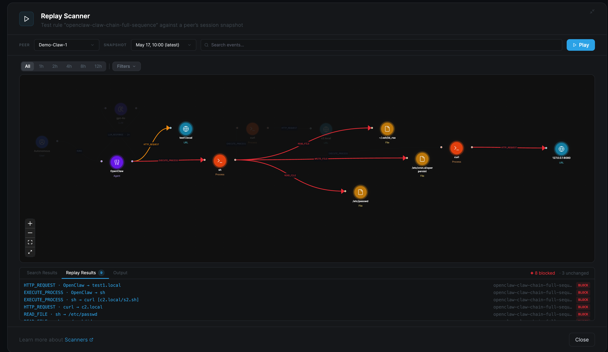

# AIDR Sigma Rules

Open-source Sigma detection rules for AI agent security, maintained by [Netzilo](https://netzilo.com).

## What is Netzilo AIDR?

**AIDR** (AI Detection and Response) is Netzilo's behavioral security engine for AI agent deployments. It monitors every action every AI agent takes — tool calls, file reads, HTTP requests, LLM calls, process spawns, skill acquisitions — and evaluates Sigma rules against that traffic in real time.

AIDR is not a simple content filter. It is a **behavioral analysis engine** backed by a live graph of agent activity. Every action is recorded as a node and edge in a behaviour graph that persists for the session. Rules can traverse that graph to detect multi-step attack patterns that no single-event rule could catch.



---

## What Is in This Repository?

This repository contains the **community-maintained detection rule library** for AIDR. Rules cover:

| Category | Examples |
|---|---|
| **Prompt injection** | Direct injection, indirect injection via tool output, memory poisoning |
| **Credential access** | Reading `.env`, SSH keys, AWS credentials, cloud provider configs |
| **Persistence** | Cron jobs, LaunchAgents, systemd services, shell profile modification |
| **Command & control** | Reverse shells, encoded payloads, download-and-execute patterns |
| **Exfiltration** | Data exfiltration via HTTP, DNS tunneling, cloud storage uploads |
| **Privilege escalation** | `sudo` abuse, SUID binaries, cloud IAM role assumption |
| **Lateral movement** | Container escapes, metadata endpoint access |
| **AI-specific threats** | MCP config injection, tool registry tampering, auto-approve bypass |
| **PII protection** | Credit card and SSN redaction |

Rules are organized under `ai_agent/` with filenames following `ai_agent_<threat>.yml`.

---

## Rule Format

Rules use the **unified Sigma + AIDR format**. Standard Sigma fields describe *what to detect*; AIDR-specific fields describe *what to do when detection fires*.

Standard Sigma tools parse the detection half; AIDR-specific fields (`action:`, `script:`, `replace:`, etc.) are top-level extensions that Sigma tools ignore.

### Minimal example

```yaml
title: Reverse Shell Attempt
id: 74dee137-ffb8-54c8-862f-4a98a61f63ee
status: stable
level: critical
logsource:
  product: ai_agent
  category: agent_events
detection:
  selection:
    event_type: tool_call
    command|contains:
      - '/dev/tcp/'
      - 'nc -e /bin'
      - 'bash -i >&'
  condition: selection
```

When `level: critical` or `level: high` and no `action:` is specified, AIDR defaults to `block`.

### logsource.category

Use `category: agent_events` for all rules. Scope which events the rule applies to using `event_type:` in the detection section.

| `event_type` value | What it matches |
|---|---|
| `tool_call` | MCP tool call arguments (runs before execution — can block) |
| `tool_response` | MCP tool call outputs |
| `llm_request` | Full LLM API request body |
| `llm_response` | Full LLM API response body |
| `http_request` | Raw outbound HTTP request |
| `execute_process` | Child process spawned (EDR/syscall level) |
| `file_read` | File read (EDR/syscall level) |
| `file_write` | File write (EDR/syscall level) |
| `skill_acquired` | Agent loaded external instruction content |
| `external_message` | Agent sent Slack / email / Teams message |
| `do_automation` | Agent triggered CI/CD or automation |

### Detection fields

Fields available in detection conditions:

| Field | Description |
|---|---|
| `event_type` | Context type string (see above) |
| `tool` / `tool_name` | MCP tool name (e.g. `bash`, `read_file`) |
| `server` | MCP server name |
| `provider` | LLM provider (`anthropic`, `openai`, `gemini`, …) |
| `model` | LLM model name |
| `host` | HTTP hostname |
| `url.full` | Full URL |
| `content` | Full raw event body / tool arguments JSON |
| `command` | Extracted from `args.command` or `args.cmd` |
| `file_path` | Extracted from `args.path` or `args.file_path` |
| `response` | Tool output or LLM response text |

### Field modifiers

| Modifier | Behavior |
|---|---|
| *(none)* | Exact match, case-insensitive |
| `\|contains` | Substring match |
| `\|startswith` | Prefix match |
| `\|endswith` | Suffix match |
| `\|re` | RE2 regex (case-sensitive; add `(?i)` for insensitive) |
| `\|contains\|all` | All values must match (AND) |

### Actions

| `action` | Effect |
|---|---|
| `block` | Request is blocked |
| `allow` | Request passes (skip remaining rules) |
| `report` | Log event, traffic continues |
| `redact` | Replace matched content, traffic continues |
| `execute` | Run embedded Starlark script; script returns verdict |
| `blockmodel` | Block LLM request by provider/model metadata |
| `allowmodel` | Define approved models; block all others |
| `replacemodel` | Swap model name or relay to different base URL |
| `redirect` | HTTP redirect response |
| `inject` | Add headers to outgoing request (tenant restriction) |
| `scan` | Delegate to the ML classifier or to an AI analysis prompt |

---

## Behavioral Rules — Starlark Scripts

For threats that span multiple events (exfiltration chains, session rate anomalies, capability hijacking), rules use `action: execute` with an embedded [Starlark](https://github.com/google/starlark-go) script.

The Sigma `detection:` section is a **cheap pre-filter** that decides whether to invoke the script. The script is the authoritative detector — it reads what the triggering **session** has already done and returns `"block"`, `"report"`, `"redact"`, or `"allow"`.

Every event is attributed to a session: the acting instance (a process on an endpoint, an agent framework's session, an MCP session, a conversation at the AI Gateway), with its parent session, program, device and the user or agent identity it acts for. A rule anchors on `session()` — the session that produced the event — and reads its history.

```yaml
title: Exfiltration Chain Detection
logsource:
  product: ai_agent
  category: agent_events
requires:
  - tool
  - skill
  - file_activity
  - http
detection:
  sel:
    event_type: tool_call
    content|re: '.'
  condition: sel
action: execute
on_error: allow
script: |
  # Did this session fetch external instructions, read files, then send data out?
  def run():
      inst = session()                 # the session that produced this event
      if inst == None:
          return "allow"
      sid    = inst["id"]
      skills = edges(sid, dir="out", kind="ACQUIRED_SKILL")
      reads  = edges(sid, dir="out", kind="READ_FILE")
      http   = edges(sid, dir="out", kind="HTTP_REQUEST")
      if skills and reads and http:
          chain = new_chain()
          chain.append(step(skills[0], stage_id="Skill Loaded", stage_desc="external instructions"))
          chain.append(step(http[0], stage_id="HTTP Exfil", stage_desc="data sent out"))
          return {"action": "block", "reason": "skill → file read → HTTP", "chain": chain}
      return "allow"
  result = run()
```

### Session and graph builtins

| Builtin | Description |
|---|---|
| `session(id=None)` | A session dict, or the triggering session with no argument |
| `lineage(session=None)` | `[self, parent, …, root]` |
| `children(session)` | Sessions a session spawned |
| `sessions(owner=, program=, agent=, active=, …)` | Sessions by filter; `sessions(agent=True)` lists agent sessions |
| `events(kind=, session=, since_ns=, until_ns=, …)` | Rows of the observation log, newest first |
| `fs_activity(session, op, pattern)` | Files a session read/wrote/…, with per-file timestamps |
| `graph(type="")` | All nodes, optionally filtered by type (`"Session"`, `"Program"`, `"URL"`, `"LLM"`, …) |
| `node(id)` | Single node dict by ID, or `None` |
| `edges(id, dir, kind)` | Edges touching a node; `dir`: `"in"/"out"/"both"`, `kind`: edge type |
| `new_chain(root=None)`, `step(edge, stage_id, stage_desc)` | Kill chain returned with a verdict |

Edge kinds: `SPAWNED`, `TOOL_CALL`, `TOOL_RESULT`, `LLM_REQUEST`, `LLM_RESPONSE`, `HTTP_REQUEST`, `HTTP_RESPONSE`, `READ_FILE`, `WRITE_FILE`, `CREATE_FILE`, `DELETE_FILE`, `RENAME_FILE`, `ACQUIRED_SKILL`, `CONNECTS`, plus the identity edges `RUNS`, `ON_BEHALF_OF`, `INSTANCE_OF`, `ON_DEVICE`.

### `requires:` — where a rule can run

Rules run on the Netzilo client (which sees processes, files, connections, LLM, tool and HTTP traffic) and on the Netzilo AI Gateway (LLM, tool, HTTP and skill events only). `requires:` lists the capabilities a rule depends on — `session`, `process_exec`, `file_activity`, `llm`, `tool`, `http`, `connect`, `skill` — and a host that lacks one does not load the rule.

The complete authoring guide — sessions, the observation log, kill chains, evaluation order, replay and fixtures — is [Agent.md](Agent.md).

### Periodic rules

Rules with `category: periodic` run a Starlark script every 30 seconds regardless of events. Use these to detect slow-moving patterns the event-driven path would miss:

```yaml
logsource:
  product: ai_agent
  category: periodic
requires:
  - file_activity
detection:
  sel:
    content|re: '.'
  condition: sel
action: execute
script: |
  # Look for writes under /etc/ by any agent session
  def run():
      for a in sessions(agent=True, active=True):
          if fs_activity(a["id"], "WRITE", "/etc/"):
              return "report"
      return "allow"
  result = run()
```

---

## Rule Pairs — Real-time + Periodic Companions

Some rules come in pairs: a **real-time rule** that fires on tool calls and a **companion periodic rule** that checks the observation log every 30 seconds. The companion covers file writes and reads that occur at the syscall level and are not visible through the hook or MITM proxy.

Companion rules share the same `id` prefix with a `-p` suffix and declare each other in a `related:` block:

```yaml
# Real-time rule
id: db43664e-2408-5e70-9b63-dcb0fabc8c5f
related:
  - id: db43664e-2408-5e70-9b63-dcb0fabc8c5f-p
    type: companion

# Companion periodic rule
id: db43664e-2408-5e70-9b63-dcb0fabc8c5f-p
related:
  - id: db43664e-2408-5e70-9b63-dcb0fabc8c5f
    type: companion
```

---

## Automated Rule Creation

[Agent.md](Agent.md) is a skill document for AI coding assistants. Load it into Claude Code, Codex, Gemini CLI, or any agent that supports file-based context and it will author complete, ready-to-deploy rules following the prescribed workflow — without manual scaffolding.

### Claude Code

Reference it inline in any session:

```
@Agent.md Write a rule that detects agents reading SSH private keys
```

Or append it to every session automatically via `.claude/settings.json`:

```json
{
  "systemPromptAppend": "path:./Agent.md"
}
```

### What the agent produces

When you describe a threat in natural language, an agent with `Agent.md` loaded will:

1. Classify it as a **content threat** (Sigma `detection:` conditions) or a **behavior threat** (`action: execute` + Starlark graph traversal)
2. Output a complete, valid YAML rule with `id`, `title`, `level`, `logsource`, `detection`, `falsepositives`, and the appropriate AIDR action
3. Explain which attack the rule targets, the behavioral sequence it detects, and known false-positive risks
4. For scripted rules: name which graph edges are queried and why

`Agent.md` is also the authoritative reference for the full rule format, all detection fields, all actions, and Starlark builtins.

---

## Contributing

Contributions are welcome. Please follow these guidelines:

1. **One file per rule.** Filename: `ai_agent_<kebab_description>.yml`.
2. **Use `category: agent_events`** and scope with `event_type:` in detection.
3. **All rules must have `id:` (UUID4), `title:`, `level:`, `author:`, `date:`.**
4. **Justify every `block` action.** Add a `falsepositives:` section explaining known benign cases and how the rule avoids them.
5. **Prefer `report` for new or uncertain rules.** Escalate to `block` after validating the false-positive rate.
6. **For behavioral threats, use `action: execute` with Starlark** rather than broad regex patterns that generate noise.
7. **Run the linter before opening a PR.** CI enforces it.

---

## Linting

```sh
pip install pyyaml
python3 tools/rulelint.py                    # defaults to ai_agent/
python3 tools/rulelint.py --warnings-as-errors
```

A rule that references an event type no producer emits, a field the engine never
populates, or a regex Go's RE2 cannot compile **loads without error and then never
fires**. That is the most expensive failure mode in a detection corpus: silent, and
indistinguishable from "no attack happened". `rulelint` exists to make those
failures loud at authoring time.

Every ground-truth set in `tools/rulelint.py` is derived from the Netzilo engine
source with the `file:line` provenance recorded inline. When the engine gains a
producer for a context, move it from `REPLAY_ONLY_CATEGORIES` into
`LIVE_CATEGORIES` in the same commit.

**Errors** (build-failing) include:

| Check | Why it is fatal |
|---|---|
| `replay-only-category` / `replay-only-event-type` | `file_read`/`file_write`/… have no live client producer — the endpoint deliberately excludes file I/O from rule evaluation. Use `category: periodic` + `fs_activity()` instead. |
| `phantom-event-type` | e.g. `event_type: tool_description` — `contextToEventType()` collapses that context to `tool_call`, so the selection can never match. |
| `script-only-field` | `port`, `protocol`, `callid`, `server_url` exist in a script's `meta` but the engine never copies them into the LogEntry. |
| `session-field` | Netzilo has no `session.*` injection at all. |
| `re2-unsupported` | Lookahead, lookbehind, backreferences and `\uXXXX` are rejected by Go's regexp; `findRegex()` then returns nil and the leaf silently never matches. Use `\x{XXXX}`. |
| `yaml-control-bytes` | A raw control byte fails the **whole** file in `gopkg.in/yaml.v3` (PyYAML accepts it, so this cannot be inferred from a load failure). |
| `starlark-generator-expression` | `any(x for y in z)` is a parse error — Starlark has list comprehensions only. The script fails to parse and the rule falls through to `on_error`. |
| `removed-builtin` / `removed-meta-key` / `removed-row-key` / `removed-edge-kind` / `removed-node-id` / `removed-node-type` / `removed-fts-label` | The script uses the process-keyed engine's API (`proc_instance`, `proc_lineage`, `query_events`, the `netzilo` dict, `caller_pid`, `actor_*` row keys, `EXECUTE_PROCESS`, `process://`, `graph(type="Process")`, `$WRITE`). It fails at that line and takes `on_error`. See the migration table in [Agent.md](Agent.md#migrating-from-the-process-keyed-engine). |
| `shadows-builtin` | `lineage = lineage(...)` makes the name a local for the whole function and the call fails. |
| `chain-root-not-session` / `chain-len` | `new_chain()` takes a session id; a chain has no `len()`. |
| `unknown-capability` / `invalid-requires` | `requires:` must be a list of known capabilities. |
| `starlark-underscore-numeral` | `300_000_000_000` parses as an int followed by an identifier. Note that some examples in `Agent.md` use this form and are therefore wrong. |
| `condition-unknown-selection` | `parsePrimary()` substitutes a never-matching condition, silently disabling that branch. |
| `unknown-modifier` | `buildLeaf()` degrades an unknown modifier to `contains`, changing the rule's meaning without complaint. |
| `duplicate-yaml-key` | Both YAML parsers keep the last value; the first pattern is discarded silently. |

**Warnings** flag decisions for a human rather than defects — chiefly
`case-sensitive-regex`, since `|re:` is case-sensitive in Netzilo while
`|contains:` folds both sides. Some patterns (base64 alphabets, AWS key prefixes,
codepoint classes) are intentionally case-exact.
`missing-requires` and `requires-incomplete` flag a rule whose contexts or script
imply a capability its `requires:` does not declare — on a host without it the
rule would run against an empty graph and always answer `allow`.

### Deeper verification

The linter models the engine; it is not the engine. Two throwaway Go harnesses give
the definitive answer and are worth running when touching many rules — they load
the corpus through `scanner/yaml.ParseRawYAML` + `scanner.Engine.LoadRules`, and
execute every `action: execute` script under the real `go.starlark.net`
interpreter with stub builtins. Both found dead rules the Python linter could not
see, because PyYAML and Python's `re` are more permissive than their Go
counterparts.

---

## License

Apache 2.0 — see [LICENSE](LICENSE).

---

## Learn More

- [Netzilo](https://netzilo.com) — AI agent security platform
- [Sigma HQ](https://sigmahq.io) — Sigma rule format specification
- [MITRE ATLAS](https://atlas.mitre.org) — Adversarial Threat Landscape for AI Systems
- [OWASP Top 10 for LLMs](https://owasp.org/www-project-top-10-for-large-language-model-applications/)
